# Work dependency graph

Generated from the authoritative `progress/ledger.json` on the current source snapshot. Required gates and the new discovered work are both shown. Solid arrows are hard dependencies (prerequisite → dependent); dashed arrows are support/unblock links into a required outcome. The required denominator is unchanged: discovered work is supplemental and cannot earn required credit.

```mermaid
flowchart TB
  classDef done fill:#d9f2e3,stroke:#1f7a4d,color:#073b24;
  classDef active fill:#fff0c2,stroke:#a66a00,color:#4a3000;
  classDef blocked fill:#ffd9d6,stroke:#b3261e,color:#5c120e;
  classDef req fill:#e8eefc,stroke:#4b5b86,color:#1b2745;
  classDef disc fill:#f5e8ff,stroke:#7a3fa0,color:#321047;
  subgraph M0["M0 · Scoped record ready for owner review (0/5 accepted)"]
    ZOM_REC_01["ZOM-REC-01<br/>Reconcile pinned kit and repeat installer replay<br/><small>Agent A</small>"]
    ZOM_REC_02["ZOM-REC-02<br/>Approve the scoped product baseline<br/><small>Agent A</small>"]
    ZOM_REC_03["ZOM-REC-03<br/>Validate and review branded progress views<br/><small>Agent A</small>"]
  end
  subgraph M1["M1 · Observed WSE2 baseline (0/5 accepted)"]
    ZOM_ENG_01["ZOM-ENG-01<br/>Verify complete original ZOMBIEEE 0.4 archive<br/><small>Agent A</small>"]
    ZOM_ENG_02["ZOM-ENG-02<br/>Boot the original module with supported WSE2<br/><small>Agent A</small>"]
    ZOM_ENG_03["ZOM-ENG-03<br/>Complete baseline City zombie wave<br/><small>Agent A</small>"]
    ZOM_OBS_01["ZOM-OBS-01<br/>Validate game-event telemetry inside WSE2<br/><small>Agent C</small>"]
    ZOM_OBS_02["ZOM-OBS-02<br/>Collect crash-resistant external host evidence<br/><small>Agent C</small>"]
  end
  subgraph M2["M2 · One-click Windows solo start (0/5 accepted)"]
    ZOM_WIN_01["ZOM-WIN-01<br/>Discover installed licensed Warband and WSE2<br/><small>Agent B</small>"]
    ZOM_WIN_02["ZOM-WIN-02<br/>Deliver safe install, repair and rollback<br/><small>Agent B</small>"]
    ZOM_WIN_03["ZOM-WIN-03<br/>Create user desktop launcher and settings<br/><small>Agent B</small>"]
    ZOM_SOLO_01["ZOM-SOLO-01<br/>Automatically start private invasion host<br/><small>Agent B</small>"]
    ZOM_SOLO_02["ZOM-SOLO-02<br/>Join solo player without manual server setup<br/><small>Agent B</small>"]
  end
  subgraph M3["M3 · City survivor AI and combat reliable (0/5 accepted)"]
    ZOM_AI_01["ZOM-AI-01<br/>Verify allied defender team and initial spawns<br/><small>Agent A</small>"]
    ZOM_AI_02["ZOM-AI-02<br/>Establish measurable effective ranged combat<br/><small>Agent A</small>"]
    ZOM_AI_03["ZOM-AI-03<br/>Verify guarded positions and recovery behaviour<br/><small>Agent A</small>"]
    ZOM_WAVE_01["ZOM-WAVE-01<br/>Balance survivor help and zombie wave progression<br/><small>Agent A</small>"]
    ZOM_PERF_01["ZOM-PERF-01<br/>Measure actual frame pacing and agent costs<br/><small>Agent C</small>"]
  end
  subgraph M4["M4 · City-first solo release accepted (0/5 accepted)"]
    ZOM_QA_01["ZOM-QA-01<br/>Produce one auditable end-session diagnosis<br/><small>Agent C</small>"]
    ZOM_QA_02["ZOM-QA-02<br/>Complete sustained integrated City solo test<br/><small>Agent C</small>"]
    ZOM_ADMIN_01["ZOM-ADMIN-01<br/>Verify private cheat authority and behavior<br/><small>Agent A</small>"]
    ZOM_LEGAL_01["ZOM-LEGAL-01<br/>Resolve publication rights and attribution<br/><small>Agent B</small>"]
    ZOM_REL_01["ZOM-REL-01<br/>Package City-first accessible solo v1.0 candidate<br/><small>Agent B</small>"]
  end
  subgraph DISC["New discovered work · 2026-10-24 live loop"]
    ZOM_DISC_30["ZOM-DISC-30<br/>Community Warband AI behavior research + hold/fire/speed prototype<br/><small>Agent C</small>"]
    ZOM_DISC_31["ZOM-DISC-31<br/>Cited Warband AI community source pack and licence limits<br/><small>Agent E</small>"]
    ZOM_DISC_32["ZOM-DISC-32<br/>No-launch AI/profile matrix and pre-launch gate<br/><small>Agent F</small>"]
    ZOM_DISC_33["ZOM-DISC-33<br/>Rear defensive line and 8-defender spawn_agent refill<br/><small>Agent A</small>"]
    ZOM_DISC_34["ZOM-DISC-34<br/>Gate native wave visitors to slow Zombie 894<br/><small>Agent A</small>"]
    ZOM_DISC_35["ZOM-DISC-35<br/>Community-backed zombie speed clamp and team hold/fire orders<br/><small>Agent A</small>"]
    ZOM_DISC_36["ZOM-DISC-36<br/>Speed/order/movement/wave-2/refill telemetry<br/><small>Agent C</small>"]
    ZOM_DISC_37["ZOM-DISC-37<br/>Installer uninstall/repair + desktop/settings + release gate<br/><small>Agent F</small>"]
    ZOM_DISC_38["ZOM-DISC-38<br/>Publication rights, credits and redistribution gate dossier<br/><small>Agent E</small>"]
    ZOM_DISC_39["ZOM-DISC-39<br/>Sealed task-34 validation of refill, rear line and wave-1 gating<br/><small>Agent D</small>"]
  end
  ZOM_DISC_34 --> ZOM_DISC_32
  ZOM_DISC_28 --> ZOM_DISC_33
  ZOM_DISC_33 --> ZOM_DISC_34
  ZOM_DISC_30 --> ZOM_DISC_35
  ZOM_DISC_33 --> ZOM_DISC_35
  ZOM_DISC_34 --> ZOM_DISC_35
  ZOM_DISC_30 --> ZOM_DISC_36
  ZOM_REC_01 --> ZOM_DISC_37
  ZOM_DISC_33 --> ZOM_DISC_39
  ZOM_DISC_34 --> ZOM_DISC_39
  ZOM_DISC_30 -.->|supports| ZOM_AI_03
  ZOM_DISC_31 -.->|supports| ZOM_LEGAL_01
  ZOM_DISC_32 -.->|supports| ZOM_QA_01
  ZOM_DISC_33 -.->|supports| ZOM_AI_03
  ZOM_DISC_34 -.->|supports| ZOM_WAVE_01
  ZOM_DISC_35 -.->|supports| ZOM_AI_03
  ZOM_DISC_36 -.->|supports| ZOM_OBS_01
  ZOM_DISC_37 -.->|supports| ZOM_WIN_02
  ZOM_DISC_38 -.->|supports| ZOM_LEGAL_01
  ZOM_DISC_39 -.->|supports| ZOM_QA_02
  class ZOM_REC_01 req;
  class ZOM_REC_02 blocked;
  class ZOM_REC_03 blocked;
  class ZOM_ENG_01 done;
  class ZOM_ENG_02 done;
  class ZOM_ENG_03 blocked;
  class ZOM_OBS_01 done;
  class ZOM_OBS_02 blocked;
  class ZOM_WIN_01 done;
  class ZOM_WIN_02 blocked;
  class ZOM_WIN_03 blocked;
  class ZOM_SOLO_01 done;
  class ZOM_SOLO_02 done;
  class ZOM_AI_01 done;
  class ZOM_AI_02 blocked;
  class ZOM_AI_03 blocked;
  class ZOM_WAVE_01 blocked;
  class ZOM_PERF_01 blocked;
  class ZOM_QA_01 done;
  class ZOM_QA_02 req;
  class ZOM_ADMIN_01 blocked;
  class ZOM_LEGAL_01 req;
  class ZOM_REL_01 blocked;
  class ZOM_DISC_30 done;
  class ZOM_DISC_31 done;
  class ZOM_DISC_32 done;
  class ZOM_DISC_33 active;
  class ZOM_DISC_34 active;
  class ZOM_DISC_35 active;
  class ZOM_DISC_36 done;
  class ZOM_DISC_37 active;
  class ZOM_DISC_38 active;
  class ZOM_DISC_39 done;
```

## New discovered work (owner / while / effect)

| ID | Owner | Occurred while | State | Depends on | Supports | Graph effect |
| --- | --- | --- | --- | --- | --- | --- |
| ZOM-DISC-30 | Agent C — research/prototype; owner retains runtime acceptance | task-30 live owner test; survivors charging + sprint complaints | done | — | ZOM-AI-03 | Unblocks task-38 speed/hold implementation; supports ZOM-AI-02/ZOM-AI-03/ZOM-WAVE-01. |
| ZOM-DISC-31 | Agent E — provenance/credits; owner retains release acceptance | task-30/35 research sweep | done | — | ZOM-LEGAL-01 | Feeds task-35 synthesis and legal/attribution review. |
| ZOM-DISC-32 | Agent F — launcher/test harness; owner retains release acceptance | task-34 validation queue | done | ZOM-DISC-34 | ZOM-QA-01 | D pre-launch gate for wave/refill/hold validation. |
| ZOM-DISC-33 | Agent A — implementation; Agent D sealed it; owner retains acceptance | task-30 rear-line live owner test | active | ZOM-DISC-28 | ZOM-AI-03 | Keeps the AI squad alive; prerequisite for speed/hold tuning and wave survival. |
| ZOM-DISC-34 | Agent A — implementation; Agent D validating | task-34 wave-2 Fast Zombie wipe | active | ZOM-DISC-33 | ZOM-WAVE-01 | Blocks strong/mounted wave spikes; must pass before ZOM-WAVE-01 balance can be judged. |
| ZOM-DISC-35 | Agent A — implementation; Agent D validation | owner speed/charge complaints after task-30 | active | ZOM-DISC-30, ZOM-DISC-33, ZOM-DISC-34 | ZOM-AI-03 | Primary unblock for ZOM-AI-03 hold behavior and ZOM-WAVE-01 balance; depends on research + rear line + wave gating. |
| ZOM-DISC-36 | Agent C — telemetry; Agent D re-seal | task-38 preparation; no speed/order readback existed | done | ZOM-DISC-30 | ZOM-OBS-01 | Unblocks proof for task-38 and D&#x27;s final validation. |
| ZOM-DISC-37 | Agent F — implementation; owner retains release acceptance | M2 milestone review | active | ZOM-REC-01 | ZOM-WIN-02 | Supports ZOM-WIN-02/ZOM-WIN-03 and ZOM-REL-01; cannot close M2 alone. |
| ZOM-DISC-38 | Agent E — evidence; owner/legal acceptance | M4 legal/publication gate | active | — | ZOM-LEGAL-01 | Supports ZOM-LEGAL-01 and blocks ZOM-REL-01 until owner decisions/qualified review. |
| ZOM-DISC-39 | Agent D — sealed validation; owner retains acceptance | task-34 validation run | done | ZOM-DISC-33, ZOM-DISC-34 | ZOM-QA-02 | Supports ZOM-QA-02; waves.max=1 leaves wave-2 acceptance open. |

## How to read the frontier

- Start at the required milestone gates at the top. A gate is accepted only when its own criterion is met; a discovery node cannot substitute for it.
- A solid arrow means the dependent node is blocked until its prerequisite is at least resolved. `ZOM-DISC-35` (speed/hold patch) depends on research (`30`), rear line/refill (`33`) and wave gating (`34`).
- A dashed arrow is not acceptance: it is the discovered work opening or supporting a required outcome (for example `30 → ZOM-AI-03`, `34 → ZOM-WAVE-01`).
- The current frontier is `ZOM-DISC-35` (A implementing), `ZOM-DISC-34` (wave-2 not yet observed), `ZOM-DISC-37` (M2 installer/release) and `ZOM-DISC-38` (M4 legal gate). `ZOM-DISC-38` keeps `ZOM-REL-01` blocked.
- `ZOM-DISC-39` is evidence, not acceptance: sealed 8-file task-34 run with 8 defenders refilled, rear positions and wave-1 894 only; wave 2 stayed unobserved in the 3-minute window.
