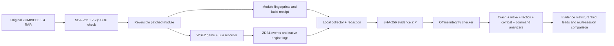

# ZOMBIEEE 0.1.8 — Forensic evidence and private controls

**Purpose:** develop against the original ZOMBIEEE Beta 0.4 without requesting constant manual playtests, then diagnose one integrated WSE2 session using objective, source-linked records. Every patch is opt-in and made to a verified local copy of the original archive. ZOMBIEEE2 is excluded.

## Evidence pipeline



No third-party server, network telemetry, GitHub Actions or raw RAR upload is required. Logs are collected locally only after the final integrated Windows session. The redaction filter is best-effort; inspect bundles before sharing.

## Commands — local listen host, one player only

Enable with `--private-commands`. Requires `--experimental-defenders 3..8 --all-map-defenses --wave-reinforcements --tactical-recovery`. This option is mutually exclusive with periodic `--solo-assist`.

| Keyboard chord | Native action | Recorded counter |
| --- | --- | --- |
| **Left Ctrl+F7** | Full health for living survivor host | `zdr_cmd_heal` |
| **Left Ctrl+F8** | Refill ammunition for living survivor host | `zdr_cmd_ammo` |
| **Left Ctrl+F9** | Heal/rearm only living non-player AI defenders in divisions 5–7 | `zdr_cmd_squad` |

The compiled mission explicitly checks server authority, **not a dedicated server**, left Ctrl being held, the function key being clicked, exactly **one active player**, the local host agent being alive and on survivor team 0. Counters advance only after those checks. The three counters are appended to `variables.txt` with a separate mission-start reset trigger; original variable IDs are unchanged.

There is no remote chat command, external RPC endpoint, cheat-code web panel or anti-cheat bypass. Network/player counting and actual keyboard input are **not verified in WSE2** and therefore cannot yet be called secure in production. Use only in a private final test.

## Survivor-support difficulty profiles

The profile influences **survivor reinforcement timing** and **tactical retreat thresholds**; it does not claim to edit original zombie damage, speed, count or loot.

| `--difficulty` | Reinforcement begins | Fall back with AI count at/below | Regroup with AI count at/above |
| --- | ---: | ---: | ---: |
| `story` | Wave 1 | 2 | 3 |
| `standard` (default) | Wave 2 | 1 | 3 |
| `hard` | Wave 3 | 1 | 3 |
| `nightmare` | Wave 4 | 0 | 3 |

A nonstandard difficulty requires the wave-reinforcement patch. All profiles retain the existing once-per-wave replenishment cap, the original zombie wave mechanism and server-only commands. This is a **support difficulty**, not a comprehensive balanced difficulty mode.

## Combat recorder, only when WSE2 operation bindings are available

The runtime Lua recorder now has a small, locally written `lua/msfiles/header_operations.py` binding file for read-only Warband operation names. This follows WSE2's documented MS operation loading mechanism; actual loader compatibility remains untested.

At bounded 15-second intervals, the recorder attempts to sample up to 16 *non-player, survivor-team, division-5–7* agents, and only then records:

- Agent and division IDs, wave and heartbeat tick (no human names or chat)
- Equipped weapon numeric item ID, ammunition count and current agent kill count, if the native getters exist
- Rounded X/Y position if available, to connect combat behaviour with tactical order changes
- Original wave and round globals, tactical state, reinforcement state, and private hotkey counters

Unavailable APIs produce unknown values (usually `-1`) rather than artificial zeros. If all getters are absent, the analyzer says combat telemetry is unavailable, not that the bots have no kills.

## Forensic rules, not verdicts

| Rule | Evidence required |
| --- | --- |
| R023 | Weapon ID known, ammo observed at zero for at least 3 consecutive samples while zombies are present |
| R024 | At least two AI agents with known kill counters, at least 6 server samples with zombies, and zero observed kill increases |
| R025 | Executed native command marker does not match a command-enabled build receipt |
| R026 | Experimental defenders enabled and server heartbeat exists, but no valid combat samples |

Other rules R001–R022 remain active for resources, engine crashes, native scripts, Lua probes, wrong builds, stale logs, bot teams, stalled waves and tactical immobility.

An evidence matrix independently labels engine boot, mission entry, zombies visible, wave progress, reserved AI present, observed AI kills, fallback, regroup, private command execution and fatal log errors. **Unknown means not verified.** A change of wave number is recorded as progression, not proof of successful wave completion; an absence of crash text is not proof of stability.

## Full opt-in experimental build

```powershell
py -3 tools\build.py --archive "C:\Downloads\ZOMBIEEEBeta04.rar" --out "C:\Games\MountBlade Warband\Modules\ZOMBIEEE_Remaster" --experimental-defenders 4 --defender-loadouts balanced-ai --all-map-defenses --wave-reinforcements --tactical-recovery --private-commands --difficulty story
```

That creates **35 invasion mission triggers**, **1,225 global variables** and **985 troop records**: 25 original invasion triggers preserved, plus the 10 remaster-added triggers. The private keyboard controls add 4 triggers (one counter reset and three commands) and three globals. The default build remains at 25 invasion triggers with no remaster gameplay modifications.

### One final Windows test, later

After the complete remaster is ready, run one private WSE2 session, then close the game and run the existing `tools/Collect-Diagnostics.ps1` command. Inspect the redacted ZIP and share it for a consolidated diagnosis. The offline report will explain what was *observed*, what is *unknown*, and which failure should be fixed first.

**Current boundary:** local Python/compiled-data tests verify structure and original-record preservation. They do not verify Warband/WSE2 executable behaviour, ally marksmanship, weapon animations, scene collision, server/client authority or actual hotkey delivery. These are reserved for final integrated Windows evidence.
