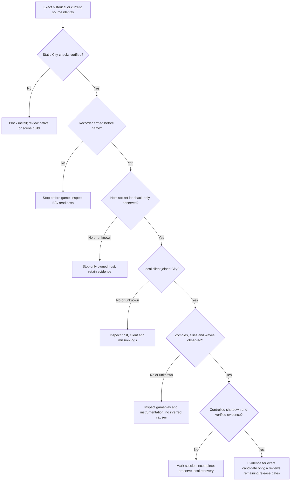

# ZOMBIEEE City-first — integration acceptance evidence ledger

## Observed first WSE2 dedicated-host checkpoint — 2026-10-24 (latest update)

**The earlier opening snapshot below predates this real host result.** Agent B [reported](https://github.com/yigit-denktas/MBW-ZOMBIEEE-Mod/pull/11#issuecomment-6376361668) the owner-authorized City-only build from **A `141a792`**, B `d41aefc`, and C recorder **`e455354`**. Actual launched SHAs differ from the *initial* announced A/C versions; use the observed installed candidate, not assumptions about the plan.

- **G03 scoped observed source/build check:** B reports archive CRC accepted; staged balanced-AI City profile built in 29 seconds with `city_static_acceptance` (26 passing checks, source-derived invasion mode 7), `city_final_acceptance.passed=true`, native mission **31 triggers**, and canonical City SCO SHA `96159fa8…`. New module `Modules/ZOMBIEEE_Remaster` installed **1,071 files** without overwriting prior modules. An independent **after-install** verifier result has not been posted, and this is **not** acceptance of B's unimplemented journaled P1 installer.
- **G06 scoped observed recorder readiness:** C `e455354` passive recorder armed first; canonical readiness marker and HMAC-attached owned host/client processes accepted. **Final signed stop, sealed manifest and manual privacy review remain unknown**.
- **G07 scoped observed real dedicated-host boot/private listener:** Actual WSE2 1.1.5.4 host emitted `ZDB1|boot|version=0.1.8|triggers=31`; logged `Starting map tbfc_invasion_4 in mode multiplayer_iv`. Agent B observed **UDP listener `127.0.0.1:7240` only**, with no public UDP listener. Reported outbound TCP to Cloudflare is **not an inbound listener**. Host startup/socket privacy are now *observed for this identified running candidate*, not blanket future-run evidence.
- **G08–G11 remain OPEN:** the player **had not joined** when B posted the observation. No independently confirmed server-side client join, wave progression, defender AI combat, or round reset/hold-order behavior. Map-selection log and a Lua boot marker are not proof of complete invasion playability.
- **New observed error and research task:** Four real engine `SCRIPT ERROR: Invalid Faction ID: -1` messages at original `mst_multiplayer_iv` **trigger 14 consequences, opcode 502**. Cause and effect remain **unknown** pending Agent A original-vs-generated compiled source audit. C added bounded **R030 / CITY-I08** noncausal identification, but its full exact-current suite remains unverified; no automatic root-cause assignment or remediation is authorized by the error text alone.

The present A source branch was independently reported at **149/149 local original-asset tests**, which is source evidence, not proof the running module contains those later diagnostics edits. C's newer forensic branch code was not the launched `e455354` recorder. Do not combine source revisions to manufacture current-candidate acceptance.

**Progress reporting is separate:** [Canonical Project Record ledger](https://github.com/yigit-denktas/MBW-ZOMBIEEE-Mod/blob/project-record-setup-v041/progress/ledger.json) now tracks 18 **● discovered** source/incident/support tasks (11 narrowly completed, 6 in review, 1 active) without additional credit to the original **0/23** required release outcomes or **0/5** accepted milestones. [Incident-driven scope amendment](https://github.com/yigit-denktas/MBW-ZOMBIEEE-Mod/blob/project-record-setup-v041/progress/scope-changes/2026-10-24-live-incident-amendment.json).

---

**Agent A, 2026-10-24. Gate contract, not a report of completed gameplay.**

The baseline at publication is **A `141a7926dc2102cc521208d0170cc55f8f80b74f`** (round-aware City native patch; core **31 triggers / 1,223 globals**, optional private controls **35 / 1,226**), **B `d41aefc0d7b810f0e1ca0c5961c71f107e5d0052`**, and **C `e4553547cbca5e3e46e4570dae9b77ccc5c02bcd`** (incident counter fix). These are independently evolving **draft** PRs; pin new SHAs explicitly if any changes before the final candidate. Current branch SHAs alone are not evidence of installed bytes.

At this writing B has **announced** an owner-authorized private Windows attempt with **older A `2643321` and C `53c2f88`**, but has **not posted its completion results**. A historical-candidate session, even if successful, cannot certify unexecuted new A/C source revisions. Do not interrupt a running session merely to chase hashes, mislabel its version, or request a new gameplay attempt solely to improve bookkeeping.

## Evidence classes and strict semantics

- **Source-verified:** pinned source/asset digest and static native/scene validation of a specific candidate. Not WSE2 execution.
- **Observed:** an actual owned host/client, OS socket measurement, in-game event, or read-only recorder output from an **identified real attempt**. Explicit `simulation=false` is necessary but not sufficient. A valid log receipt can contain *no* gameplay data.
- **Unknown:** absent event, missing permission, truncated/partial log, guessed CLI flag, unproven loopback binding, stale SHA or unexecuted test. Unknown is neither success nor evidence of a particular cause.
- **Failed/blocking:** a directly observed contradiction to a mandatory invariant (public listening socket, failed verified source check, changed unauthorized original assets, unclosed owned process). A timeout is a failure to meet a deadline; it does **not** prove a particular game bug.
- **Historical-only:** valid observation tied to an older source revision; preserve in diagnostics but exclude from final-current acceptance.

A self-reported `city_static_acceptance` or `city_final_acceptance.passed=true` means **the builder claims source checks**. Agent C deliberately reports `independently_reverified=false` unless a separate checker ran. An internal SHA-256 manifest provides integrity, not provenance, playability or privacy.

## Release decision table

| Gate | Authoritative observation / action | Current evidence status | Blocker / pass threshold |
|---|---|---|---|
| G00 · Original input | User-owned Beta 0.4 RAR exact size/SHA + `7z t` every file | **SCOPED PASS**: B reports 1,068 files, exit 0; original RAR SHA pinned | New archive identity differs → BLOCK. No redistribution |
| G01 · WSE2 provenance | Actual x86 host & client matching official Warband 1.1.5.4 package SHA and upstream file blobs | **SCOPED PASS**: B reports official package + host/client matching, same owned install | Unmatched binaries or edition → BLOCK |
| G02 · Active A source | Exact checkout/test SHA used to build module; independently repeat static checks | **OPEN**: A local 144/144 source tests, but latest Windows live plan cites older A `2643321` | Same-pinned candidate, source suite OK, chain pass |
| G03 · City built files | Actual staged module inventory, original first 25 triggers unchanged, City-only scene changed, all 4 other scenes byte-identical; `city_static_acceptance` and `city_final_acceptance.passed` | **OPEN**: B announced build, did not post build receipt/result | On-stage AND after-install independent read-only verifier both pass; false → BLOCK |
| G04 · Installer transaction | Owner consent, journal-before-mutation, no target overwrite, recoverable crash and rollback failure matrix | **OPEN**: B PR #11 currently has dry-run planner; no journaled executor/rollback tests committed | Fake-fixture failures and recovery tested; manual new install is *not* installer acceptance |
| G05 · Current C diagnostics | Exact current C HEAD tested on Windows, negative ZIP privacy/count regressions | **OPEN**: previous Windows 164 full/33 skipped at **older** C `53c2f88`; count fix `e4553547` awaits rerun | Exact current C full + focused tests, report skips and failures; PII manually reviewed |
| G06 · Recorder first | C armed/readiness valid, B owns recorder handle, matching attempt, HMAC attach, log offsets recorded | **OPEN**: B/C tested with fake processes; real session result missing | Live attempt evidence; no readiness inference from PID alone |
| G07 · OS-private host | `mb_warband_wse2_dedicated.exe` boot, actual OS-observed UDP/TCP listener addresses scoped to owned PID, no public/any-interface binding | **OPEN**: B announced host start, no OS listener result posted | Nonloopback `0.0.0.0`, `::` or external interface → BLOCK and stop owned processes. Config alone ≠ proof |
| G08 · Joined City mission | Local WSE2 client joined; explicit **server-side** `multiplayer_iv`, `scn_tbfc_invasion_4`, mode 7 independently observed | **OPEN** | A client `mission_enter`, unrelated template or server-only mission without observed City scene **does not count**; see [readiness source fix](../reference/CITY_SERVER_EVIDENCE_GATING_2026-10-24.md) |
| G09 · Survivor deployment | Live server observes team-0 reserved divisions 5/6/7, traversable guard posts 2/3/4, meaningful bot behavior | **OPEN** | Source has such opcodes, but no verified movement/LOS/attack yet |
| G10 · Original zombies/waves | At least 2 actual successive distinct wave observations, original team-1 zombie counts, no unexpected wave termination; round identity when available | **OPEN** | Two distinct waves alone prove only progression, not victory/combat. Missing telemetry → UNKNOWN |
| G11 · Round transition | Actual original round reset and post-reset survivor spawn/hold/fallback/regroup persistence, repeated-wave numbered across rounds | **OPEN**: new static round-lifecycle audit flags risks, not a gameplay diagnosis | Need measured replay across rounds; **do not assume source one-shot order persists** |
| G12 · Controlled teardown | B stopped only its owned client/host, C signed stop after game exit, C manifest verified; privacy audit + manual review | **OPEN** | Incomplete C session ≠ sealed; a clean ZIP does not prove game success |
| G13 · Release decision | Reviewer connects exact active A+B+C, staged receipt, optional controls, verified runtime observations, owner acceptance | **OPEN / NOT ACCEPTED** | All mandatory gates supported by the **same** exact release candidate; no merges until review |

## Current attempt provenance — do not merge evidence from different builds

| Candidate | Source | What it can establish |
|---|---|---|
| **Historical live attempt (announced)** | B planned A `2643321`, C `53c2f88`, B `d41aefc` | If results arrive: bootstrap/process, private listener, City runtime **of that exact historical build** only |
| **Latest source candidate (not yet integrated)** | A `141a7926`, C `e4553547` | A's local source suite and C's count fix source review; **no real in-game evidence** |

A must not retroactively interpret historical-wave behavior as exercising the new `(g_round_start_time, wave_number)` reinforcement guard. C must not report runtime round IDs from source-only receipts. Avoid assuming the observed game client is configured to connect automatically; confirm actual join.

## Required path-private run receipt

For each new attempt retain privately and report a **sanitized summary** with:

```json
{
  "schema": "zombieee.city-integration-review.v1",
  "candidate": {"a_sha": null, "b_sha": null, "c_sha": null,
                "archive_sha256": null, "wse2_package_sha256": null,
                "installed_module_manifest_sha256": null},
  "scope": {"mission": "multiplayer_iv", "scene": "scn_tbfc_invasion_4",
            "expected_game_type_source": 7, "simulation": null},
  "source": {"original_crc": "unknown", "independent_city_audit": "unknown",
             "final_static_gate": "unknown", "installer_journaled": "unknown"},
  "runtime": {"recorder_armed": "unknown", "os_loopback_only": "unknown",
              "host_ready": "unknown", "client_joined": "unknown",
              "server_city_entered": "unknown", "wave_progression": "unknown",
              "survivor_groups": "unknown", "npc_combat": "unknown",
              "round_transition": "unknown", "controlled_shutdown": "unknown"},
  "evidence": {"recording_manifest_verified": null,
               "source_sha_bound_to_installed_output": null,
               "manual_privacy_reviewed": null},
  "verdict": "not_accepted"
}
```

`null` and `unknown` fields are deliberate, not defaults to pass. Only replace a status with `observed` or `failed` when accompanied by a **path-free record of how/where it was directly measured and by which owned process/session**; do not store a PID, HMAC key, user path, raw log, Steam profile or host token publicly. This JSON is an *illustrative review envelope*, not a new B/C wire format; do not feed it to the recorder as-is.

## Fault localization / response plan



## Independent round-lifecycle audit

Use **read-only** `tools/round_lifecycle_audit.py --original <owned original module> --module <fully built City module> --json` after staging and before launch. It confirms exactly what can be source-proven: original wave reset and round-start clock, mission-start defender spawn and tactical-mode initialization, effectively one-shot initial guard hold orders, and periodic wave and tactical guards. Its `runtime_verified` is always `false`; observed in-engine round transitions must still address its unknowns. No original source assets are committed to the public repo.

### Responsibility and change control

**A:** historical source/native semantics, source acceptance, round risk audit, final verdict. **B:** consent, release-pinned binaries, installer durability, owned process lifecycles, observed OS bound sockets, game startup. **C:** recorder lifecycle, provenance caveats, safe ZIP, factual incident timelines. B/C PRs are still **draft**; B's actual installer P1 and C's current exact-head suite remain separate gates. No additional speculative native features or extra owner gameplay round is justified without new measured evidence.

## First host defect triage — 2026-10-24 (Agent A)

**Scope: source and probe-field analysis only; no new runtime observation, no acceptance change.**

- **Candidate identity is now bound:** installed `Modules/ZOMBIEEE_Remaster` `mission_templates.txt`/`variables.txt`/`module.ini`/receipt are byte-identical to the staged City build (native SHA `9e8229e779023524…`, 31 triggers, 1,223 globals, `runtime_verified=false`). The **probe that produced the log was A's older overlay** (`overlay/lua/main.lua`, 8,379 bytes, SHA `1ce64f9f…`), not current C HEAD, so its limits belong to the evidence.
- **G08–G11 stay OPEN.** The client was inside the City scene (four frames, HUD 0–0, timer frozen at 5:00) but the probe reported the dedicated host as `role=client` and skipped its server-only branch, and the engine logged bound reads as an illegal lvalue. Server-side wave/team measurements from this attempt are therefore **not trustworthy**; "wave 0 / no team-1 agents" is an observation, not a proven native-controller failure.
- **Trigger-14 `Invalid Faction ID: -1` triaged:** decoded as four trailing `faction_set_slot(-1, 200, trp_invader_multiplayer_ai)` operations (consequence indices 24–27; engine line numbers are zero-based consequence indices). The generated mission's first 25 triggers are byte-identical to the pinned 2012 original, the preceding 24 valid writes target `fac_kingdom_invaders` (index 16) slots 200–243, and the failed slot 200 already held a valid troop. **Original-mod authoring bug, not a remaster defect; non-fatal, not proven causal.** No default gameplay patch is authorized — rewriting `-1 → 16` would change the wave-1 fallback troop.
- **`mode=0` is not a game-type mismatch:** the probe's `mode` field is `$zdr_defence_mode` (our tactical fallback state, source-initialized 0), never `$g_multiplayer_game_type` (source 7). The engine game type was **never observed** in this attempt.
- **Tooling:** read-only `tools/city_runtime_triage.py` plus 9 regression tests encode the above, including negative controls (remaster-introduced write, moved non-trailing write, game-type-bound probe, non-zero mode initializer, missing server gate). A-lane suite on this laptop: **158 tests, OK, zero skips** (Windows 11, Python 3.11.9, owned original module + pinned archive). Full evidence and exact lines: [runtime triage](../reference/CITY_RUNTIME_TRIAGE_2026-10-24.md).
- **One corrected controlled observation is required** (Lead-coordinated) after C's probe fix, reading game type, round-start time, bot-ready/bot counts, server role and team-1 counts. No patch, no gameplay claim, and no evidence merge across candidates before that.

